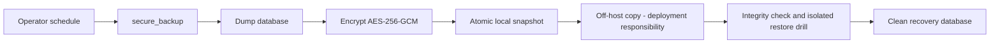

# Architecture and operating assumptions

FakeAccount is a portfolio-scale Django account application. The deployment
examples demonstrate a single-region service; they are not a claim that the
repository itself provides production-grade availability or disaster recovery.

## Requirements and limits

The following are explicit design targets, not measured guarantees:

| Area | Target / assumption |
|---|---|
| Scale | 500 registered accounts, 25 concurrent users, and 5 HTTP requests/second |
| Data | PostgreSQL database up to 25 MB and serialized fixture up to 25 MB; the current backup implementation materializes dumps in memory |
| Web availability | 99.5% monthly when deployed with monitored PostgreSQL and redundant compute |
| Interactive response | Login p95 below 500 ms at the stated load, excluding external identity providers |
| Backup freshness | RPO <= 24 hours, only when an operator-managed daily `secure_backup` schedule and an off-host copy are both healthy |
| Recovery | RTO <= 4 hours for a tested restore to a clean database; no restore-time evidence is recorded yet |
| Retention | Keep the 10 newest encrypted snapshots by default; retention is a count, not a calendar guarantee |

These are initial portfolio constraints. The repository has unit/integration
tests and a local smoke-load run, but no production load run, off-site storage
integration, alert delivery, or timed operational restore drill. Record test
date, commit, workload, hardware, and results before treating any target as
achieved.

For a reproducible local baseline, start Django with the validation environment
from the README and run:

```powershell
python manage.py runserver 127.0.0.1:8000
```

In another terminal, measure only the database-backed health endpoint:

```powershell
python scripts/load_test.py --url http://127.0.0.1:8000/healthz/ --requests 200 --concurrency 10
```

This is a smoke-load measurement, not an authentication benchmark or a
production capacity test. Record its JSON output and environment alongside any
portfolio performance claim.
The current local baseline and restore-test evidence are recorded in
[performance.md](performance.md).

## Threat model

### Assets

- Account credentials, Django sessions, login history, and user identity records.
- Database fixtures and encrypted backup snapshots.
- Django signing secret and backup encryption key material.
- Backup job state and the ability to restore service.

### Threat actors and protections

- Anonymous internet users may guess passwords, register lookalike names, forge
  forwarding headers, or submit cross-site requests. Password hashing, login
  throttling, normalized username uniqueness, trusted-proxy checks, CSRF, and
  secure cookies reduce these risks.
- A compromised application account or worker may attempt to read or replace
  backups. Backups are authenticated AES-GCM ciphertext; deployment access to
  the backup directory and key secret must be restricted independently.
- A database, worker, host, or backup-volume outage may interrupt logins or
  backups. Jobs are persisted in the same database, leases allow stale work to
  be reclaimed, and login does not perform backup I/O.
- An administrator or CI operator may accidentally expose secrets. Secrets
  belong in a secret manager or protected environment, never in source control
  or logs.

### Accepted risks and out of scope

The demo has no MFA, email verification, account recovery, multi-region failover,
object-lock/WORM storage, independent key-management service, or automated
alert destination. A database administrator can still read plaintext account
data. Encrypting backup files does not protect a compromised running process
that has access to the key. IP addresses are personal data; configure retention
and access controls for `LoginLog` and logs according to the deployment's
privacy requirements.

## Request and job flows

```mermaid
sequenceDiagram
    actor User
    participant Web as Django web
    participant DB as PostgreSQL
    participant Worker as Backup worker
    participant FS as Encrypted backup volume
    User->>Web: POST /login/
    Web->>DB: Authenticate and create session
    Web->>DB: Atomically write LoginLog + BackupEvent (if new IP)
    Web-->>User: Redirect to account; show queued status
    Worker->>DB: Claim due event with lease
    Worker->>DB: Read database snapshot
    Worker->>FS: Encrypt, fsync, atomic rename, prune old snapshots
    Worker->>DB: Mark succeeded or schedule bounded retry
    User->>Web: GET /account/
    Web->>DB: Read latest event status
    Web-->>User: Show pending, processing, success, or safe failure message
```

The database row is the queue: event creation and its associated login-history
write share one database transaction. There is no separate broker publication,
so a transactional outbox would add machinery without making this single-database
flow more reliable. If publication moves to an external broker, introduce an
outbox and an idempotent publisher before splitting the transaction.

The worker claims records conditionally, renews a processing lease, and retries
transient failures after 30, 60, 120, and 240 seconds. `BACKUP_MAX_ATTEMPTS`
(default 5) bounds automatic attempts. Exhausted jobs remain `failed` for
operator inspection; `retry_backups` is a deliberate manual retry. A filesystem
lock and snapshot digest prevent concurrent writers and duplicate backup files.
The same backup file may satisfy more than one event; event processing is
at-least-once, not exactly-once.

Decision records: [database and queue](adr/0001-database-and-job-queue.md),
[backup format and retention](adr/0002-backup-format-and-retention.md), and
[trusted proxy boundary](adr/0003-trusted-proxy-boundary.md).



Today the repository implements the encrypted local snapshot and integrity
verification. Daily scheduling, off-host replication, and automated restore
drills are deployment responsibilities and are prerequisites for the stated
RPO/RTO targets.

## Observability and alert policy

JSON application logs go to stdout. Request logs include a validated
`X-Request-ID`, status code, and duration; login outcomes and backup events are
structured separately. Passwords, session identifiers, decrypted fixtures, and
raw request bodies must never be logged. The queue is inspectable in Django
admin and through the database. `python manage.py backup_status` prints a
machine-readable snapshot of database reachability, job counts, and the age of
the oldest due/stale job for an external collector. Scheduled backoff time is
not counted as overdue work.

Connect stdout and database/backup telemetry to an external monitor. Initial
alert conditions: any failed backup job; oldest due job older than 5
minutes; no successful scheduled backup in 26 hours; database health check
failure; or a sustained login-failure rate above the deployment's agreed
threshold. Alerts require a real delivery target and owner; the demo does not
silently claim to configure one.

## Deployments, migrations, and rollback

SQLite is for local development; production examples use PostgreSQL. Apply
additive migrations before deploying code that reads the new fields. Back up
the database first, run `makemigrations --check` and tests in CI, then deploy
the web and worker from the same image. Roll back application code first if a
release is unhealthy. Do not reverse a migration that has accepted writes
without reviewing data loss and compatibility; prefer a forward corrective
migration. `next_attempt_at` is nullable so a worker can consume rows created
by an older web process during a rolling update; null means immediately due.
The sample web deployment runs migrations at startup and must stay
at one replica until migrations are moved to a dedicated job.
